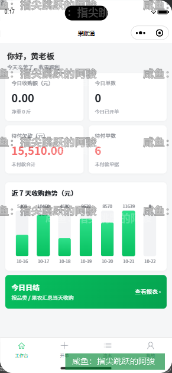
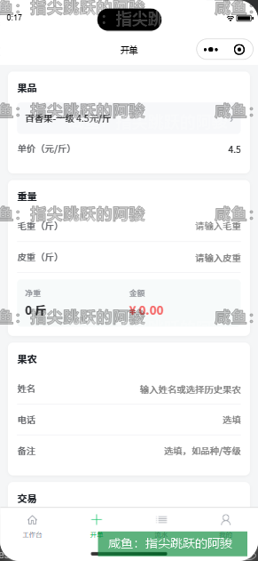
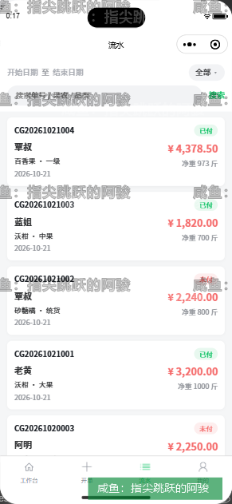
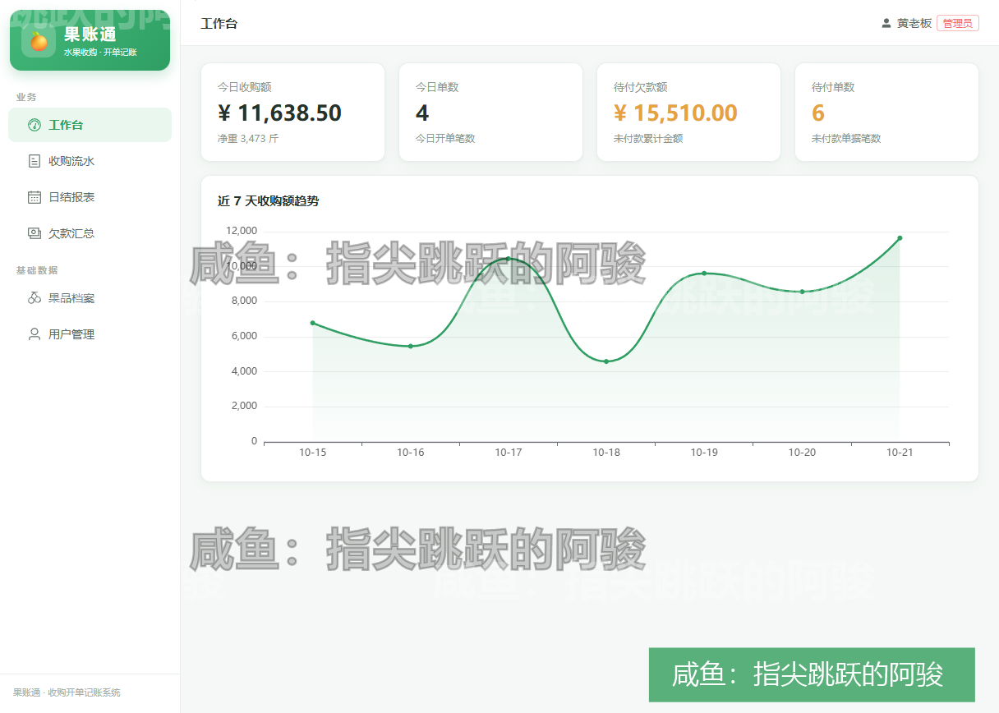
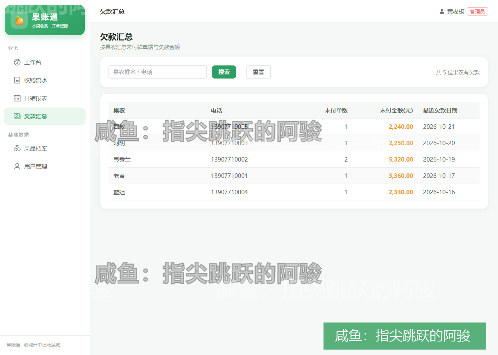
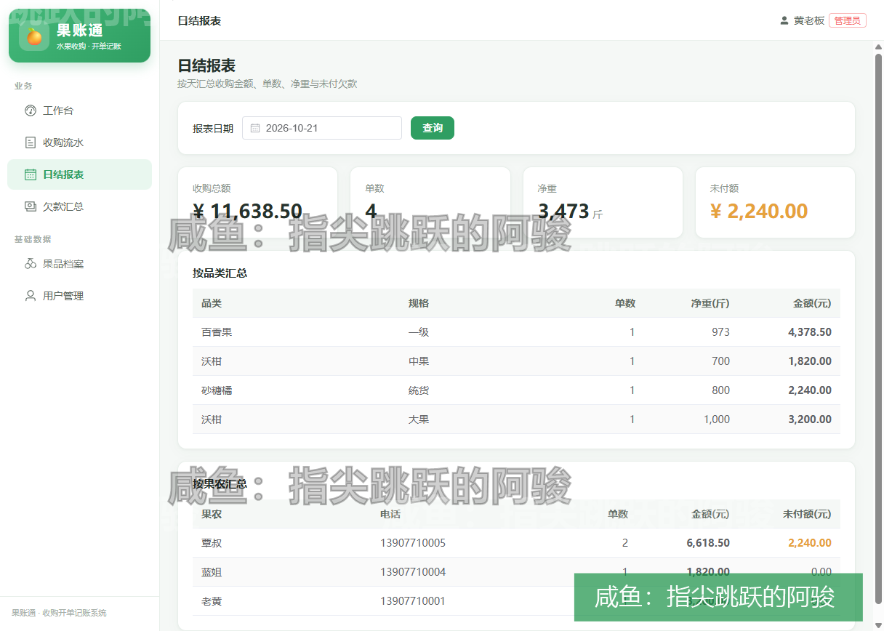

# 果账通 · 水果收购开单记账系统

> 面向水果产地收购场景的一体化记账系统：小程序开单 + PC 管理后台 + Spring Boot 后端，围绕「收购 → 欠款 → 日结」三个核心动作设计，让果农账目当天算清。

## 界面预览

**小程序端（产地开单）**

| 工作台 | 开单 | 流水 |
|---|---|---|
|  |  |  |

**PC 管理后台**

| 工作台 | 欠款汇总 | 日结报表 |
|---|---|---|
|  |  |  |

## 解决什么问题

水果产地收购的特点是：**单子多、现结与赊账混着来、月底对不上账**。

- 收购员在果库现场开单，没时间填复杂表单 → 小程序开单页按「果品 → 毛重/皮重 → 自动算净重金额」三步走，历史果农一键带出
- 赊账是常态 → 每笔单据自带付款状态，欠款汇总按果农维度聚合，谁欠多少一目了然
- 老板每天要看账 → 日结报表自动汇总当日收购额、单数、欠款，支持 Excel 导出

## 技术架构

```
miniapp（uni-app + Vue3 + TS）    收购员现场开单
admin（Vue3 + Element Plus）      老板/会计对账
        │                            │
        └──────────┬─────────────────┘
                   ▼
server（Spring Boot 3 + MyBatis-Plus + JWT）
                   │
                   ▼
              MySQL（sql/guozhangtong.sql 一键建库）
```

| 模块 | 技术栈 | 说明 |
|---|---|---|
| `miniapp` | uni-app、Vue 3、TypeScript、Vite | 微信小程序端，开单 / 流水 / 欠款 / 我的四大 tab |
| `admin` | Vue 3、Element Plus、Pinia、ECharts | PC 管理后台，工作台 / 流水 / 欠款 / 日结 / 果品档案 / 用户管理 |
| `server` | Spring Boot、MyBatis-Plus、JWT、MySQL | 单体后端，一套配置支持本地与云上部署（`GZT_*` 环境变量覆盖） |
| `deploy` | Docker Compose、Nginx | 云端一键部署：MySQL + 后端 + 前端静态托管 |
| `sql` | MySQL | 建库脚本 + 演示数据 |

## 后端模块（37 个类）

- `controller`：Auth / Dashboard / Order / Debt / Report / Fruit / User / Upload / Export
- `common`：统一 Result、分页封装、全局异常、JWT 工具
- `config`：MyBatis-Plus 分页插件、WebMvc（静态资源 / 跨域）

## 快速开始

```bash
# 1. 数据库
mysql -uroot -p < sql/guozhangtong.sql

# 2. 后端（默认连 localhost:3306/guozhangtong，账号 root/123456，可用 GZT_* 环境变量覆盖）
cd server && mvn spring-boot:run

# 3. PC 管理后台
cd admin && npm install && npm run dev

# 4. 小程序（HBuilderX 或 CLI）
cd miniapp && npm install && npm run dev:mp-weixin
# 然后用微信开发者工具导入 miniapp/dist/dev/mp-weixin
```

## 说明

- 仓库内数据均为**演示数据**（果品、果农、手机号皆为虚构），不含任何真实客户信息
- 项目由本人独立完成（需求、设计、前后端开发、部署）
